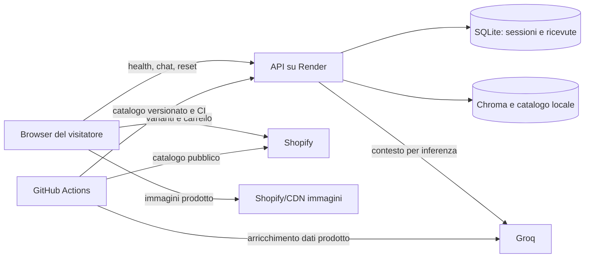

# Flussi dati e conservazione tecnica

Inventario tecnico al 15 ottobre 2026; materiale per la valutazione aziendale, non informativa definitiva o attestazione legale.

## Stato della verifica

La mappa seguente è stata ricontrollata sul codice candidato il 15 ottobre 2026. Il controllo statico conferma endpoint, payload applicativi, storage del browser, database SQLite e richieste Shopify/CDN. Google Fonts è stato rimosso dalla candidata `2026.10-rc2`: il widget integrato eredita i font del tema. Il controllo non sostituisce una cattura di rete sul tema Shopify definitivo né la verifica delle dashboard dei fornitori. Il codice applicativo non registra intenzionalmente corpi dei messaggi, credenziali di sessione o prompt completi; log di proxy, piattaforma, librerie ed eccezioni devono essere controllati nell'ambiente effettivo.

## Mappa

## Dati per percorso

| Percorso | Informazioni | Scopo / note |
| --- | --- | --- |
| Pagina → `/health` | Richiesta senza credenziali applicative e senza referrer; IP/origine e metadati di rete restano visibili al destinatario | Risveglio anche prima di aprire la chat; nessun messaggio allegato |
| Browser → `/chat` | Messaggio, ID sessione, chiave privata, ID richiesta e contesto di versione | Autorizzazione e continuità della consulenza; evitare logging del corpo |
| Browser → `/reset` | Identificatori/credenziale necessari al reset | Cancellazione coordinata dello stato applicativo della sessione |
| Backend → Groq | Prompt, messaggi/contesto e dati prodotto selezionati dal flusso | Generazione, classificazione e selezione; non presumere che venga inviato solo l'ultimo messaggio |
| Browser → Shopify | Handle prodotto, ID variante, quantità e cookie del negozio secondo le richieste same-origin | Verifica commerciale e carrello; checkout gestito dal negozio |
| Ingest/Actions → Shopify | Lettura del catalogo pubblico | Prezzi, disponibilità, descrizioni, tag, varianti e immagini |
| Enrichment → Groq | Descrizioni/tag e informazioni olfattive del catalogo | Arricchimento indipendente dalle conversazioni dei clienti |
| Browser → Shopify/CDN immagini | IP, URL risorsa e metadati tecnici | Immagini prodotto già pubblicate dal negozio; nessuna richiesta Google Fonts introdotta dal widget candidato |

Nessun nuovo account cliente è richiesto dal widget. Questo non rende anonimo il trattamento: testi liberi, IP e identificatori possono essere personali. Altri script della stessa origine possono accedere allo storage del browser; la sicurezza del tema complessivo conta.

## Archivi

| Archivio | Contenuto | Durata/comportamento osservato | Decisione residua |
| --- | --- | --- | --- |
| `sessionStorage` | Cronologia/bozza, prodotti, ID e credenziale sessione, contesto, preferenze UI | Continuità nella scheda; il ciclo reale dipende anche dal ripristino del browser | Classificazione, informativa e prove browser |
| `etualy_backend_wake_at` | Timestamp ultimo tentativo preventivo | Creato solo con `EARLY_WAKE_ENABLED = true`; limita le richieste a dieci minuti, non è cronologia visite | Classificare richiesta/storage e confermare il valore del flag per il rilascio |
| Memoria pagina | Stato UI; codice del feedback dimostrativo | Feedback disabilitato con `FEEDBACK_PREVIEW_ENABLED = false`; nessun voto creato, inviato o salvato nella candidata | Mantenere disabilitato oppure progettare e approvare una raccolta futura |
| SQLite `sessions` | History, stato guidato, prodotto attivo, revisione, token, hash della credenziale e scadenza | 24 ore di inattività; scadenza rinnovata dai completamenti | Confermare finalità/durata e persistenza |
| SQLite `chat_requests` | ID richieste, fingerprint e risposte per replay | Ricevute limitate; eliminate anche alla pulizia/reset della sessione | Valutare retention insieme alle sessioni |
| Memoria backend | Stato in esecuzione, limiti e coordinamento | Locale al processo | Non scalare senza coordinamento condiviso |
| Catalogo/Git/Chroma | Dati prodotto e arricchimenti; coda/budget dei job | Versionati o rigenerati; non archivio di chat | Diritti contenuti e manutenzione generazioni |
| Log/artifact/backup | Dipendono da piattaforma e configurazione | Artifact catalogo/audit: impostazione di 14 giorni; log hosting e backup da verificare | Owner, accessi, retention e cancellazione |

Le chiavi del browser si trovano nelle sezioni `localState`, `CHAT_STATE_KEY`, `NOTICE_KEY`, `FEEDBACK_PROMPT_KEY` e `BACKEND_WAKE_KEY` del widget. Inventariarle nuovamente dopo modifiche, senza esportarne i valori reali.

La manutenzione server parte all'avvio e ripete cicli circa ogni ora, con lotti limitati e rispetto delle sessioni occupate. Scadenza a 24 ore non significa cancellazione fisica esatta a 24 ore: processi spenti, backlog, WAL, log e backup richiedono valutazioni separate. Render Free può perdere il database prima della scadenza.

## Controlli di minimizzazione da completare

- Campionare richieste con soli dati fittizi e documentare i campi realmente inviati a Groq; non archiviare HAR completi contenenti token/cookie.
- Esaminare log degli errori oltre al percorso normale: eccezioni e librerie possono esporre informazioni non previste.
- Verificare ZDR nell'organizzazione della chiave effettiva. Il proprietario ha comunicato Global ZDR attivo; la dashboard non è stata ispezionata in questa attività.
- Verificare account, DPA, subfornitori e trasferimenti applicabili: secondo la documentazione Groq consultata il 15/10/2026, Global ZDR impedisce la conservazione dei dati cliente per affidabilità/abusi, ma i metadati d'uso restano raccolti e gli eventuali dati conservati dal servizio sono localizzati negli Stati Uniti.
- Completare il percorso R02 prima di usare dichiarazioni sanitarie come input ordinario di raccomandazione.
- Allineare la raccolta ai controlli privacy del negozio e aggiornare l'informativa dopo eventuali nuovi fornitori.

Riferimenti: [privacy del progetto](../PRIVACY_AI.md), [Groq Data Controls](https://console.groq.com/docs/your-data), [EDPB: ruoli](https://www.edpb.europa.eu/sme/learn-the-basics/data-controller-or-data-processor_en), [Garante: storage e tracciamento](https://www.garanteprivacy.it/home/docweb/-/docweb-display/docweb/9677876). Condizioni contrattuali e decisioni firmate vanno nel dossier riservato.
